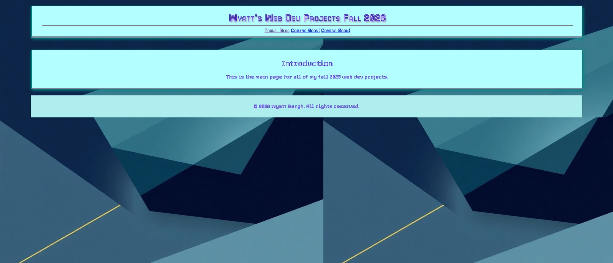

# PawfectPetCare
> Daycare, grooming, and boarding from people who treat you furry friends like family
### This is a  responsive single-page website for a fictional pet care/boarding business. Built using HTML, CSS, and Bootstrap 5.

# Landing Page

# Features
| Section |  What it does |
|---|---|
| **Sticky Navbar** | Stays at the top while scrolling and collapses to a hamburger style menu on mobile |
| **Gallery Carousel** | Three slides with captions and indicators, showing boarding, daycare, and the facility |
| **Services Cards** | Daycare, grooming, and Boarding cards side by side switch to stack one on top of another on mobile. |
| **FAQ Accordion** | Four questions that open and reveal anwsers to FAQs only one opens at a time. |

## Built With
- HTML5
- CSS3
- Bootstrap 5.3
- Font Awesome

## Responsive Design
> This page is built with a mobile first design and adjusts at bootstraps breakpoints with minor tweaks to some visual components in customs style sheet

## Getting Started
1. Clone or download this repository.
2. Open index.html in any browser.

No installation/build. Bootstrap and Font awesome load from a CDN.

## Author
**Wyatt Bergh**
- GitHub Link: https://github.com/wyattbergh-droid

*This is a student project. Pawfect Pet Care is a fictional business, and the contact details are placeholders.*